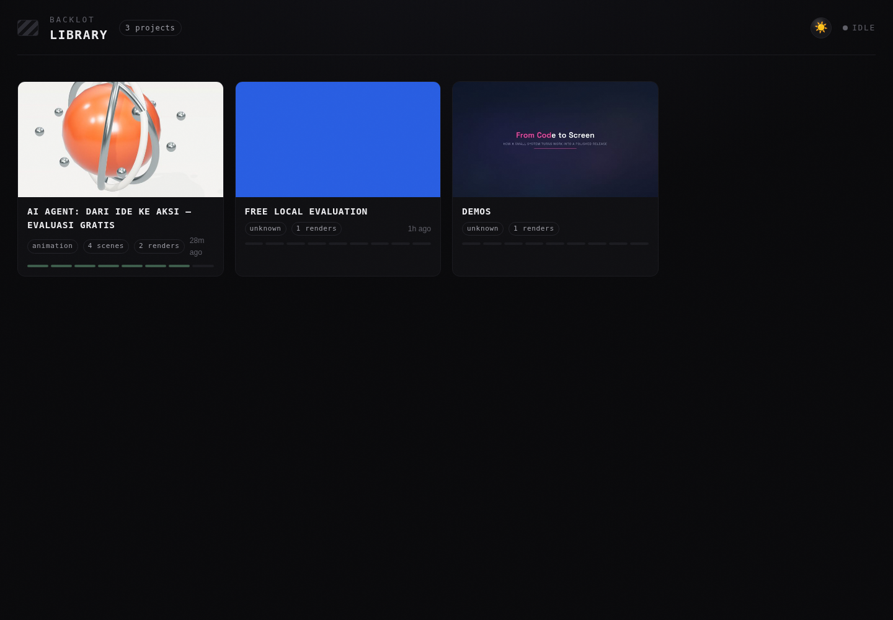

# Panduan Claude Code dan dashboard lokal

OpenMontage adalah workflow utama repo ini. Claude Code menjalankan produksi; HyperFrames/FFmpeg merender di laptop; Backlot menampilkan progres dan preview. Opuscar lama tersimpan di branch `archive/opuscar-before-openmontage`.

## Instalasi pertama di Windows

Prasyarat: Git, Python3.10+, Node24.22.1+ pada major24 (alternatif engine ada di README), FFmpeg/ffprobe, browser Chrome/Edge, dan Claude Code dengan login Pro aktif. Setup berikut memasang dependency Python/npm, bukan aplikasi prasyarat tersebut. Tidak perlu key Anthropic API atau FAL. Instalasi memerlukan internet.

Buka PowerShell di folder tempat Anda menyimpan proyek:

```powershell
git clone https://github.com/mfpm15/video-generate.git video-generate-openmontage
cd video-generate-openmontage
.\Setup-FreeLocal.ps1
.\Start-FreeClaude.ps1
```

Jika repo sudah ada di laptop, gunakan checkout `main` terbaru setelah menyimpan perubahan lokal; tidak perlu clone lagi. Jalankan launcher dari folder repo. Launcher memakai venv dan profil gratis, bukan memasang model video GPU. Status login Claude Code harus menggunakan akun Pro Anda; batas paket tetap berlaku.

## Membuat video

Di dalam percakapan Claude Code:

```text
/buat-video AI Agent untuk UMKM
```

Claude meminta deskripsi yang belum ada. Contoh jawaban:

```text
Video vertikal 20 detik untuk pemilik UMKM. Jelaskan AI membantu membalas
pelanggan dan mencatat pesanan. Caption Indonesia, objek/karakter benar-benar
bergerak, tanpa narasi, pakai aset lokal dan biaya API tambahan nol.
```

Claude memeriksa brief dan tool yang tersedia, lalu menjelaskan tiga pilihan gaya yang cocok: rupa, gerak, alasan cocok dan batasnya. Pilih salah satu atau beri arahan sendiri. Contoh izin produksi penuh:

```text
Pilih gaya terbaik secara otomatis dan lanjutkan seluruh produksi sampai QA.
Tetap sesuai brief, lokal dan tanpa API berbayar.
```

Pilihan gaya bersifat dinamis; pengguna tidak perlu mengedit STYLE.md. Sebutkan revisi lewat chat, misalnya “ubah warna menjadi biru, perbesar caption, pertahankan aksi”. Jika perubahan melampaui brief, Claude menjelaskan dampaknya sebelum menjalankan.

Judul, deskripsi dan gaya juga dapat diberikan bersama:

```text
/buat-video AI Agent untuk UMKM | Vertikal 20 detik, caption Indonesia, jelaskan balas pelanggan dan catat pesanan, tanpa suara | Pilih otomatis dan lanjut sampai QA, API tambahan nol
```

Command lain:

| Command | Fungsi |
|---|---|
| `/buat-seri Judul` | Seri video; Claude meminta deskripsi/jumlah episode jika belum jelas, membuktikan pilot lalu melanjutkan sesuai scope yang disetujui. |
| `/buat-anime Judul` | Brief animasi karakter/anime; jalur gratis lokal dan gerak harus diverifikasi, bukan zoom gambar yang disebut akting. |
| `/backlot` | Buka dashboard semua proyek. |
| `/backlot nama-proyek` | Buka storyboard dan hasil proyek tertentu. |

Command disimpan di `.claude/commands/`. Buka Claude Code dari root repo agar command dan CLAUDE.md proyek terbaca. Bila command belum muncul setelah update, keluar dan buka lagi lewat Start-FreeClaude.ps1. Anda juga bisa mengetik permintaan biasa; CLAUDE.md mengarahkan agent ke workflow yang sama.

## Antarmuka web: Backlot

Di PowerShell terpisah, dari root repo:

```powershell
.\Start-Board.ps1
```

Buka `http://127.0.0.1:4750/`. Dashboard memperlihatkan library proyek, tahapan produksi, naskah, storyboard, aset, keputusan, catatan biaya dan pemutar hasil. Proyek baru muncul saat produksi dimulai; library kosong setelah clone pertama adalah normal. Data disimpan di `projects/<nama-proyek>/` pada laptop.

Untuk satu proyek:

```powershell
.\Start-Board.ps1 nama-proyek
```

Alternatif tanpa launcher:

```powershell
.\.venv\Scripts\python.exe -m backlot open
```

Backlot adalah dashboard **baca-saja**. Input judul/deskripsi/gaya, persetujuan dan revisi dilakukan di Claude Code. Web ini tidak memiliki chat generator yang otomatis menggunakan kuota Pro. Dashboard tidak perlu API/key media dan server hanya mendengarkan loopback lokal. Menutup tab tidak menghentikan produksi Claude. Jika dashboard tidak terbuka, Claude tetap dapat menyelesaikan produksi dan memberikan path file.

Output final ada di `projects/<nama-proyek>/renders/`; minta Claude menunjukkan path final yang lulus QA. Folder projects diabaikan Git: simpan/cadangkan video Anda secara terpisah. Script `scripts/verify-local-mp4.py` memeriksa file encoded dan decode penuh; review visual, caption dan gerak tetap diperlukan.

## Apa yang telah dan belum diuji

- Satu produksi motion graphics3D OpenMontage: 12detik,1080×1920,24fps, caption Indonesia dan AAC hening. Render lokal di executor cloud, decode penuh, caption pada batas scene dan playback browser diuji.
- 47 tes preflight/budget/framework contract lulus pada evaluasi awal. Tambahan313tes referensi skill, contract dan state/API Backlot lulus. Dashboard nyata diuji di Chromium: library, empat scene, delapan tahap, dan preview final diputar sampai selesai tanpa error JavaScript. Laporan ada di docs/evaluation/.
- Ketersediaan file skill dan lolos tes contract tidak membuktikan semua pipeline/provider telah menghasilkan video. Interaksi command di Claude Code Pro milik pengguna belum dijalankan di laptop; command telah ditinjau dan jalur render dibuktikan lewat executor.
- Windows/PowerShell dan performa laptop pengguna belum diuji langsung. Claude mungkin perlu memperbaiki dependency/browser berdasarkan preflight laptop yang sebenarnya.
- Anime generatif dengan akting natural, semua seri panjang, voice/TTS, model GPU dan provider cloud belum terbukti pada jalur ini. GPU Intel terintegrasi/RAM16GB tidak memberi jaminan inference video berat.

Biaya API media tambahan ditargetkan $0. Pro yang sudah dimiliki tetap berlangganan dan memiliki batas penggunaan. Anggaran cap$0/launcher/instruksi agent adalah guard workflow, bukan firewall. Jangan memasukkan credential provider berbayar atau menganggap seluruh adaptor upstream gratis.

## Contoh tampilan web yang sudah diuji



[Lihat storyboard dan pemutar hasil](docs/evaluation/backlot-project.png). Ini screenshot proyek evaluasi di cloud, bukan proyek yang otomatis ikut terunduh saat clone.
